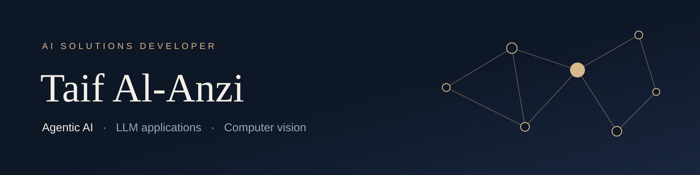
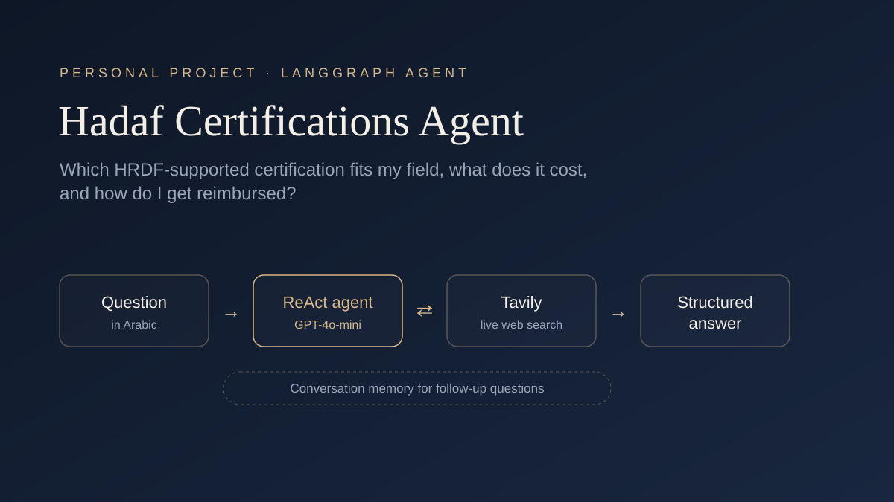

 

Hi, I'm Taif. I studied Information Systems at Najran University, and these days I build AI applications: agents that search and reason over real information, and vision features that change how an app behaves.

I usually start from the problem and the people who have it, then work out where AI actually helps. That habit comes straight from my IS background.

 

## Projects

<table>
<tr>
<td width="50%" valign="top">

<h3><a href="https://github.com/taifl2/hadaf-certifications-agent">Hadaf Certifications Agent</a></h3>
An Arabic agent that tells job seekers which HRDF-supported certifications fit their field, what they cost, and how to claim reimbursement. It searches the web live and remembers the conversation.
  
Python · LangGraph · OpenAI · Tavily &nbsp;|&nbsp; Personal project
</td>
<td width="50%" valign="top">

<h3><a href="https://github.com/Attocus/Attocus">Attocus</a></h3>
An AI study room built with three teammates. My part: when the camera spots a phone, the study timer pauses, and when the phone goes down a short quiz pulls the student back in. I also built the full-screen study view and the Firestore contact form, and worked on dark mode and Arabic/English support.
  
React · TypeScript · FastAPI · OpenAI · Firestore · YOLO · MediaPipe &nbsp;|&nbsp; Team of 4
</td>
</tr>
</table>

## Certifications

**Agentic AI Engineering** &nbsp;·&nbsp; SDAIA 
**Agentic AI Bootcamp** &nbsp;·&nbsp; Saudi Digital Academy × WeCloudData, 2026 
**AWS AI Practitioner learning path** &nbsp;·&nbsp; Saudi Digital Academy & MCIT, 2026

## What I work with

**Languages** &nbsp; Python, TypeScript 
**AI** &nbsp; LangGraph, LangChain, OpenAI API, Tavily 
**Vision** &nbsp; YOLO, MediaPipe 
**Web & data** &nbsp; React, Firebase / Firestore 
**Tools** &nbsp; Git, Jupyter, Google Colab

## Right now

Learning to evaluate LLM answers properly instead of eyeballing them, and turning notebook prototypes into tested Python projects.

 

<a href="https://www.linkedin.com/in/taifalanzi/">LinkedIn</a>

