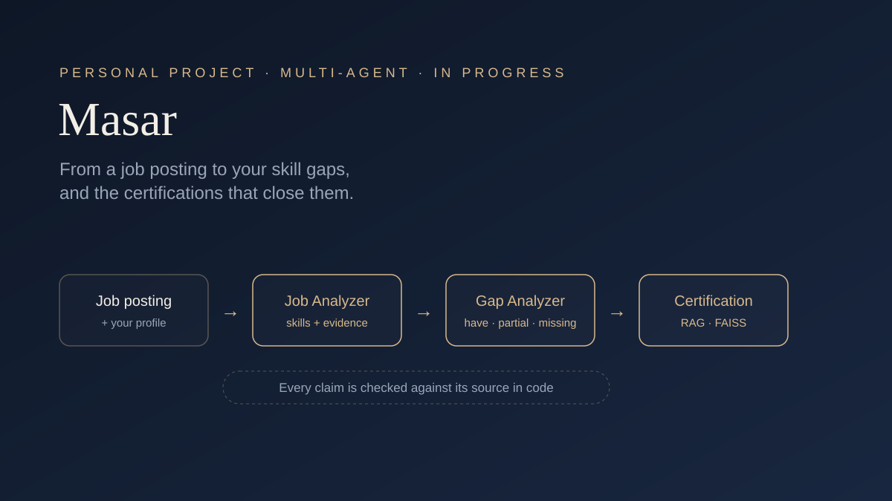
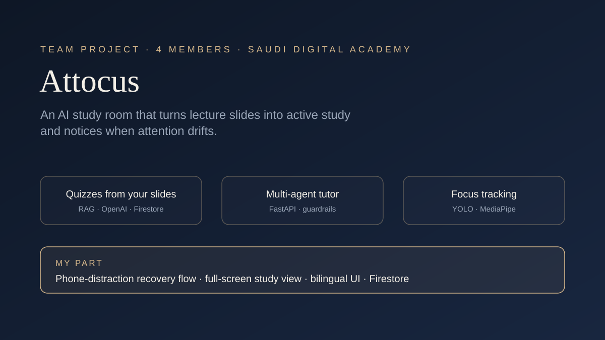

  <a href="#about-me">About</a> &nbsp;·&nbsp;
  <a href="#featured-projects">Projects</a> &nbsp;·&nbsp;
  <a href="#earlier-work">Earlier work</a> &nbsp;·&nbsp;
  <a href="#leadership">Leadership</a> &nbsp;·&nbsp;
  <a href="#certifications">Certifications</a> &nbsp;·&nbsp;
  <a href="#contact">Contact</a>

## About me

I'm Taif, an Information Systems graduate from Najran University. I build technology for real problems, and lately that means AI: language-model agents that search and reason, retrieval systems that stay grounded in their sources, and computer vision that changes how an app responds.

AI isn't the only thing I've built. I've worked on an AR and AI assistant for pilgrims, an augmented-reality experience that helps children through physical therapy, and an oil-recycling robot that represented Saudi Arabia at the World Robot Olympiad in Singapore. Outside projects, I led my university's programming club, led a hackathon and innovation expo, and have been an IBM SkillsBuild and Oracle ambassador.

What ties it together is how Information Systems taught me to think: understand the process and the people in it first, then choose the technology that actually helps.

## Featured projects

<table>
<tr>
<td width="50%" valign="top">

<h3><a href="https://github.com/taifl2/masar">Masar</a></h3>
Paste a job posting and your profile: three agents find the skills you have, the ones you're missing, and the certifications that close the gap. Every claim is checked against its source in code.
  
Python · LangChain · Groq · FAISS · sentence-transformers &nbsp;|&nbsp; In progress
</td>
<td width="50%" valign="top">

<h3><a href="https://github.com/taifl2/hadaf-certifications-agent">Hadaf Certifications Agent</a></h3>
An Arabic agent that tells job seekers which HRDF-supported certifications fit their field, what they cost, and how to claim reimbursement, with live web search and conversation memory.
  
Python · LangGraph · OpenAI · Tavily &nbsp;|&nbsp; Prototype
</td>
</tr>
<tr>
<td width="50%" valign="top">

<h3><a href="https://github.com/Attocus/Attocus">Attocus</a></h3>
An AI study room built by a team of four within a SDAIA program. It turns lecture slides into quizzes, offers an AI tutor, and uses the camera to notice when attention drifts. My part: developing the agent, building the user interfaces, and the Firestore databases.
  
React · TypeScript · OpenAI · Firestore · YOLO · MediaPipe &nbsp;|&nbsp; Team of 4
</td>
<td width="50%" valign="top">
<h3>What I'm doing now</h3>

- Building **Masar** week by week: planner and reviewer agents next, then a Streamlit interface
- Learning to evaluate LLM answers with test sets instead of judging them by eye
- Turning notebook prototypes into tested Python projects
</td>
</tr>
</table>

## Earlier work

| Project | What it is | Recognition |
|---|---|---|
| **ReOil** | A robot that helps recycle oils into an alternative to fossil fuels (team project) | Top 6 in Saudi Arabia · represented the Kingdom at the World Robot Olympiad (WRO) 2025 international final in Singapore |
| **Bunyan** | An AR/VR experience that helps children through physical therapy | 3rd place, Innovathon |
| **UniReco** | Graduation project (team): a system for managing academic recommendation letters | |
| **Wjhny** | An assistant for pilgrims that combines augmented reality with AI | |

## Leadership

- **Programming Club Team Lead**, Najran University (the club placed 3rd among the university's clubs)
- **Hackathon & Innovation Expo Leader**
- **IBM SkillsBuild, Oracle & Hult Prize Ambassador**
- **Student Advisory Council Representative** for Information Systems

## Certifications

**Agentic AI Engineering** &nbsp;·&nbsp; SDAIA 
**Agentic AI Bootcamp** &nbsp;·&nbsp; Saudi Digital Academy × WeCloudData, 2026 
**AWS AI Practitioner learning path** &nbsp;·&nbsp; Saudi Digital Academy & MCIT, 2026

## Tools I've used

  

**AI & data:** LangGraph · LangChain · OpenAI API · Groq · Tavily · FAISS · sentence-transformers · YOLO · MediaPipe · Jupyter / Colab

## Contact

  

